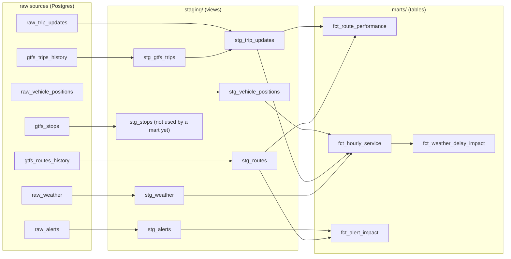

# Torino Pulse


[](https://github.com/imantahami/torino-pulse/actions/workflows/dbt-ci.yml)

A production data pipeline that continuously ingests live public transit and weather data for Turin, Italy, transforms it through a layered dbt model, and exposes findings through live dashboards.

**At a glance**
- **What it does:** collects GTT's GTFS-Realtime feeds (vehicle positions, stop-level delays, alerts) and Open-Meteo weather every 5–15 minutes, around the clock, since 19 August 2026.
- **How:** Airflow ingests into Postgres, dbt builds 11 models (7 staging views, 4 mart tables) with 42 tests, and Metabase serves a live public dashboard.
- **What it found:** buses and trams are about 93% "not more than 5 minutes late" (comparable to Hamburg's S-Bahn), but strictly on time (±60 s) only about 27% of the time, because timetables are padded and vehicles run early. Dated numbers are in [Findings](#findings).


**Live dashboard:**
[Turin Transit Dashboard](http://84.8.253.68:3000/public/dashboard/c893e417-08cc-4a87-b405-8a33fba2a81a)
---

## Why this exists

Turin's transit operator (GTT) publishes GTFS-Realtime feeds — vehicle positions, stop-level delay predictions, and service alerts — but nothing persists them. Each request returns a snapshot that is overwritten seconds later.

This project captures those snapshots on a schedule, stores them, and builds a historical record you can actually query: how the fleet size changes across the day, which routes deviate most from schedule, how weather correlates with service.

The interesting problems here are not the happy path. They are the ones documented under [Implementation notes](#implementation-notes): a dependency conflict that left every task silently failing while the containers reported healthy, a UID mismatch that made dbt die without printing anything, and a feed that emits `0` where it means `null`.

---

## Architecture

```
┌─────────────────────────────────────────────────────────────┐
│  SOURCES                                                    │
│                                                             │
│  GTT GTFS-RT          GTT GTFS-RT        GTT GTFS-RT        │
│  vehicle_position     trip_update        alerts             │
│  (protobuf)           (protobuf)         (protobuf)         │
│                                                             │
│  GTT Static GTFS      Open-Meteo                            │
│  (zip, 13 MB)         (JSON)                                │
└──────────────────────────┬──────────────────────────────────┘
                           │
              ┌────────────▼────────────┐
              │  AIRFLOW 2.10.4         │
              │  CeleryExecutor         │
              │                         │
              │  7 DAGs:                │
              │  · positions    5 min   │
              │  · trip_updates 5 min   │
              │  · alerts      15 min   │
              │  · weather     15 min   │
              │  · static_gtfs  daily   │
              │  · dbt_transform 15 min │
              │  · dbt_test      6 hours│
              └────────────┬────────────┘
                           │
              ┌────────────▼─────────────┐
              │  POSTGRES 13             │
              │                          │
              │  raw_vehicle_positions   │
              │  raw_trip_updates        │
              │  raw_alerts              │
              │  raw_weather             │
              │  gtfs_* (7 tables, incl. │
              │    1.1M stop_times rows) │
              └────────────┬─────────────┘
                           │
              ┌────────────▼────────────┐
              │  DBT 1.8.2              │
              │                         │
              │  staging/  (7 models)   │
              │  marts/    (4 models)   │
              │                         │
              │  42 data quality tests  │
              └────────────┬────────────┘
                           │
              ┌────────────▼────────────┐
              │  Metabase               │
              │  Live dashboards        │
              │  :3000                  │
              └─────────────────────────┘
```

Everything runs in Docker Compose on one Oracle Cloud VM.Standard.A1.Flex (2 OCPU ARM64, 12 GB RAM, 100 GB disk) in the Italy North (Turin) region — permanently free.

---

## Data sources

| Source | Format | Interval | What it gives you |
|---|---|---|---|
| `vehicle_position.aspx` | GTFS-RT protobuf | 5 min | Vehicle ID, route, trip, lat/lon, bearing, GPS timestamp |
| `trip_update.aspx` | GTFS-RT protobuf | 5 min | Per-stop arrival delay in seconds, license plate, wheelchair accessibility |
| `alerts.aspx` | GTFS-RT protobuf | 15 min | Service disruptions: cause, effect, severity, affected routes and stops |
| `gtt_gtfs.zip` | GTFS static | daily | About 200 routes, 6,900 stops, 1.1M stop_times; `trip_id`s rotate with every new feed |
| Open-Meteo | JSON | 15 min | Temperature, precipitation, wind speed, WMO weather code |

No API keys required. The realtime feeds carry fewer fields than the GTFS-RT spec allows — `current_status`, `occupancy_status`, and `congestion_level` are all absent from GTT's output. Everything GTT does publish is stored.

---

## Stored columns

Everything the feeds publish is stored. Timestamps are UTC; staging models add local (Europe/Rome) time.

### Raw tables

| Table | Written by | Columns |
|---|---|---|
| `raw_vehicle_positions` | positions DAG | `id`, `vehicle_id`, `vehicle_label`, `route_id`, `trip_id`, `trip_start_time`, `trip_start_date`, `latitude`, `longitude`, `bearing`, `gps_timestamp`, `fetched_at` |
| `raw_trip_updates` | trip-updates DAG | `id`, `trip_id`, `route_id`, `trip_start_time`, `trip_start_date`, `vehicle_id`, `vehicle_label`, `license_plate`, `wheelchair_accessible`, `stop_sequence`, `arrival_delay_seconds`, `departure_delay_seconds`, `gps_timestamp`, `fetched_at`, `trip_schedule_relationship`, `stop_schedule_relationship`, `arrival_time`, `departure_time`, `feed_timestamp` |
| `raw_alerts` | alerts DAG | `id`, `alert_id`, `content_hash`, `cause`, `effect`, `severity_level`, `header_text`, `description_text`, `url`, `active_period_start`, `active_period_end`, `informed_route_id`, `informed_stop_id`, `informed_trip_id`, `first_seen_at`, `last_seen_at`, `times_seen`, `fetched_at` |
| `raw_weather` | weather DAG | `id`, `observed_at`, `temperature_c`, `precipitation_mm`, `wind_speed_kmh`, `weather_code`, `fetched_at` |
| `gtfs_*` (routes, stops, trips, stop_times, ...) | static GTFS DAG | the standard GTFS columns plus `loaded_at`; rebuilt daily |
| `gtfs_trips_history` | static GTFS DAG | `trip_id`, `route_id`, `direction_id`, `trip_headsign`, `first_seen_at`, `last_seen_at`; never dropped |
| `gtfs_routes_history` | static GTFS DAG | `route_id`, `agency_id`, `route_short_name`, `route_long_name`, `route_desc`, `route_type`, `route_url`, `route_color`, `route_text_color`, `first_seen_at`, `last_seen_at`; never dropped |

`trip_id` values are reused across service days, so a trip is identified by `trip_id` plus `trip_start_date`. The realtime `route_id` is empty in `raw_trip_updates`; it is resolved through `gtfs_trips_history`. Since 4 November 2026 a delay that GTT does not send is stored as `NULL`; earlier rows store the protobuf default `0` (see [Data quality notes](#data-quality-notes)). Trips without any stop update, such as cancelled ones, get one trip-level row.

### Mart columns

| Model | Columns |
|---|---|
| `fct_route_performance` | `route_id`, `route_short_name`, `route_long_name`, `route_mode`, `service_area`, `is_night_route`, `observations`, `trips_observed`, `avg_delay_seconds`, `median_delay_seconds`, `p90_delay_seconds`, `stddev_delay_seconds`, `max_early_seconds`, `max_late_seconds`, `pct_late`, `pct_early`, `pct_on_time`, `pct_not_late_3min`, `pct_not_late_5min`, `pct_wheelchair_accessible`, `first_observed_at`, `last_observed_at` |
| `fct_hourly_service` | `hour_bucket`, `local_hour`, `local_day_name`, `local_day_of_week`, `is_weekend`, `active_vehicles`, `active_routes`, `vehicles_on_a_trip`, `position_reports`, `delay_observations`, `trips_observed`, `avg_delay_seconds`, `median_delay_seconds`, `pct_late`, `avg_temperature_c`, `total_precipitation_mm`, `avg_wind_speed_kmh`, `had_precipitation`, `dominant_condition`, `is_sparse_hour` |
| `fct_alert_impact` | `route_id`, `route_short_name`, `route_long_name`, `route_mode`, `service_area`, `alert_id`, `effect`, `cause`, `severity_level`, `header_text`, `stops_affected`, `active_from_local`, `active_until_local`, `planned_duration`, `is_currently_active`, `first_seen_at_local`, `last_seen_at_local`, `times_observed` |
| `fct_weather_delay_impact` | `dominant_condition`, `had_precipitation`, `local_hour`, `local_day_name`, `weather_group`, `hours_observed`, `avg_temp_c`, `avg_precip_mm`, `avg_wind_kmh`, `avg_median_delay`, `avg_delay`, `avg_pct_late`, `avg_fleet_size` |

---

## Model layers

### staging

| Model | Purpose |
|---|---|
| `stg_vehicle_positions` | Drops `(0,0)` GPS readings. Adds local time and `has_assigned_trip`. |
| `stg_trip_updates` | Resolves `route_id` via the GTFS history. Adds prediction drift columns, `is_latest_observation` and `is_en_route`. |
| `stg_alerts` | Collapses alert/entity pairs, carries the observation window. |
| `stg_weather` | Deduplicates per observation time. Translates WMO codes to conditions. |
| `stg_gtfs_trips` | `trip_id` → route lookup built from `gtfs_trips_history`. |
| `stg_routes` | Human-readable names, transport mode, urban/extra-urban, night flag. |
| `stg_stops` | Coordinates and wheelchair boarding, filtered to valid geometry. Not used by any mart yet. |

### marts

| Model | Grain | Purpose |
|---|---|---|
| `fct_route_performance` | one row per route | Median, p90, stddev, punctuality bands |
| `fct_hourly_service` | one row per local hour | Fleet size + delay + weather, joined |
| `fct_alert_impact` | one row per (route, alert) | Which lines are disrupted and how |
| `fct_weather_delay_impact` | one row per (condition, precipitation, local hour) | Delay grouped into dry / rainy / foggy buckets |

### Lineage



Generated from each model's actual `ref()`/`source()` calls, not hand-drawn — `fct_weather_delay_impact` is the one mart built on another mart rather than directly on staging. Full column-level docs (including tests and descriptions) are available locally via `dbt docs generate && dbt docs serve`.

---

## Data quality notes

### GPS dropouts
About 2.3% of vehicle positions report `latitude = 0, longitude = 0`. Filtered in staging.

### A feed that emits `0` where it means "no data"
Before 4 November 2026 about 33% of stop-time updates had `arrival_delay_seconds = 0`. Three checks suggested these were missing data rather than punctual arrivals: the zero rate was 31–34% at every stop position, 2,229 of 6,717 trips reported zero at every single stop, and 80% of vehicles sat firmly in one camp (always zero or never zero). `fct_route_performance` therefore excluded them.

That could not be proven from the data then, so the collector was changed on 4 November 2026 to store a delay only when GTT actually sets the field (protobuf returns `0` for an unset integer, so the field presence is checked explicitly). On the rows collected since, **28.7% are `NULL` and only 0.1% are exactly zero** (`analysis/data_quality.sql`).

The live feed shows why: each stop update carries either `arrival.delay` or `arrival.time` (an absolute predicted arrival), never both (233 and 94 of 327 stop updates in one fetch, which is 28.7% again). The "zeros" were stop updates whose prediction was an absolute time that the collector did not read. Those times are not placeholders: converted to a delay against the timetable, they have a median of −64 s, 27.9% within ±60 s and only 0.2% exactly zero (`analysis/arrival_time_check.sql`), close to the rows that report a delay directly. A trip uses one form for all its stops (1,944 delay-only and 772 time-only trips in the latest 150,000 rows, none mixed), and some routes use only the time form (for example 49, 46, 76, 30, 43, 63 and 14).

The consequence is a coverage gap: `fct_route_performance` still filters on `arrival_delay_seconds <> 0`, so it only sees trips that report a delay, and routes that publish only absolute times are missing or under-represented. Route-level rankings should be read with that in mind. The similar distribution of the two forms suggests the network-level figures are not materially biased, but that is not proven. Deriving the delay from `arrival_time` is the next change; delays before 4 November cannot be recovered because the time was not stored.

### First stop always reads zero
The first stop reports zero delay because the vehicle has not departed. The `is_en_route` flag (`stop_sequence > 1`) excludes it.

### Delay drifts negative along a trip
In the first analysis, median delay fell steadily with stop position: −25s at stop 2, −59s at stop 5, −98s at stop 15. Vehicles get progressively further ahead of schedule — suggesting padded timetables toward the end of routes.

### Three things that shaped the history behind the marts

**`trip_id` is reused across service days.** GTT publishes the same `trip_id` for a scheduled trip on every day it runs, so a trip is identified by `trip_id` plus `trip_start_date`. Until 3 November 2026 the window functions in `stg_trip_updates` were partitioned by `(trip_id, stop_sequence)` only, which made every later day's observation supersede the earlier ones: `is_latest_observation` kept just the last day each trip was seen. The partitions now include `trip_start_date`; `fct_route_performance` went from roughly 0.7M to 2.8M observations and its history now reaches back to 19 August.

**Route attribution depends on feed history.** The realtime feed leaves `route_id` empty, and GTT rotates `trip_id`s with each new static feed. The static GTFS tables are rebuilt daily, so before 3 November 2026 an old observation could only be matched to a route if its `trip_id` was still in the current feed. `gtfs_trips_history` and `gtfs_routes_history` now keep every `trip_id` and route ever seen, but only from that date onward. Observations whose `trip_id` was never captured have no route and are left out of the route-level marts, so route-level figures lean on recent weeks while the share without a route shrinks each day. The monthly breakdown is in the [Findings snapshot](#route-attribution-coverage).

Network-level punctuality does not need a route and was stable at 23.6–27.8% in every month when last measured, so the headline OTP is not an artefact of which routes could be resolved; route rankings are. Weather and fleet-size figures come from `fct_hourly_service`, which does not depend on route attribution.

**No trip-update data on 10–11 September 2026.** `raw_trip_updates` has no rows on those two days, although vehicle positions were collected normally. `fct_hourly_service` therefore has no delay figures for them. There is nothing to backfill.

---

## Findings

Everything in this section is a **dated snapshot**. The dashboard above shows the live numbers, and the queries behind each figure are in [`analysis/findings.sql`](analysis/findings.sql), [`analysis/data_quality.sql`](analysis/data_quality.sql) and [`analysis/route_coverage.sql`](analysis/route_coverage.sql), meant to be re-run as the window moves. The sections after the snapshot date explain how to read the figures and do not depend on them.

### Snapshot: 11 November 2026

Data collected since **19 August 2026** (84 days), with one gap: `raw_trip_updates` is empty on 10–11 September. The route-level figures cover **4.84M delay observations on 99 routes**. Route attribution is incomplete for the earliest months, and routes whose trips report arrival times instead of delays are under-represented (see [Data quality notes](#data-quality-notes)), so read route rankings with care. Weather and fleet figures do not depend on route attribution.

### Network-level punctuality vs European benchmarks

Operators define "on time" differently, so a comparison only means something on the same definition. Hamburg's HVV counts a vehicle as punctual when it is **not more than a few minutes late**; early arrivals are not penalised. GTT publishes no official tolerance. The table puts Turin on that same one-sided basis (`pct_not_late_3min` and `pct_not_late_5min` in `fct_route_performance`):

| Network | Mode | Punctuality | Definition and source |
|---|---|---|---|
| Hamburg HVV | U-Bahn | 98.0% | 2025, HVV press release PM260123 |
| Hamburg HVV | S-Bahn | 93.6% | 2025, HVV press release PM260123 |
| **GTT Turin** | **Bus** | **93.3%** | arrival less than 5 min late, 3.66M observations |
| **GTT Turin** | **Tram** | **93.0%** | arrival less than 5 min late, 1.15M observations |
| European average | — | ~75% | quoted figure, source not verified |
| London TfL | — | 76% | quoted figure, source not verified |

Turin's metro (line M1) is left out: its data covers only 19–21 August 2026 (22,272 observations), so it is not comparable with the other rows (see [Known gaps](#known-gaps)).

Two caveats. First, the Turin figures come from GTT's *predicted* delay at each stop (the last prediction per trip, stop and day) rather than measured arrivals, and stops that report no usable delay are excluded (see [Data quality notes](#data-quality-notes)). Second, the HVV thresholds (3 min for U-Bahn, 5 min for buses) and the two "quoted figure" rows have not been checked against the operators' own definitions, so read the table as indicative.

On a strict symmetric ±60 s window, which penalises early arrivals, Turin's OTP is only about 27% (network 27.4% across 4,838,348 observations, bus 27.7%, tram 26.4%). That reflects a structural pattern, not random variation: the network runs systematically ahead of schedule (network median delay −62 s), which means timetables are padded and vehicles arrive early rather than on time. A rider who arrives at the scheduled departure time risks missing a vehicle that left early.

### Buses and trams are close

| Mode | Routes | Observations | OTP (±60s) | pct_late | Median delay | Not >5 min late |
|---|---|---|---|---|---|---|
| Bus | 88 | 3,661,703 | 27.7% | 22.9% | −61s | 93.3% |
| Tram | 9 | 1,150,898 | 26.4% | 21.6% | −66s | 93.0% |
| Metro | 1 | 22,272 | 22.1% | 11.1% | −119s | 98.5% |
| Funicular | 1 | 3,475 | 29.8% | 18.0% | −66s | 97.4% |

Mode-level figures are weighted by observations; "median delay" is the observation-weighted average of each route's median, not a median over all observations. Trams are late less often than buses (21.6% vs 22.9%) but also arrive early more often (median −66s vs −61s), which is why their ±60s OTP comes out slightly lower. On the one-sided thresholds the two modes are indistinguishable: 93.3% vs 93.0% at 5 minutes and 88.3% vs 88.5% at 3 minutes. The metro row covers three days in August and the funicular 17 days (23 August to 9 September), so neither is comparable to the bus and tram figures.

### Most problematic routes

Routes with the highest rate of late arrivals (observations ≥ 200):

| Route | pct_late | p90 delay | stddev | observations |
|---|---|---|---|---|
| 17 | 41.8% | +471s | 2,414 | 159,518 |
| 17/ | 37.0% | +379s | 276 | 43,022 |
| VEX | 36.8% | +388s | 317 | 1,015 |
| 68+ | 34.0% | +348s | 295 | 15,911 |
| 61 | 33.0% | +369s | 274 | 98,564 |
| 4 | 32.5% | +349s | 1,300 | 331,545 |

Route 17 and its variant 17/ have been at the top in every reading since October, so this looks like a persistent pattern rather than a one-off. Routes with a trailing `/` (such as `17/` and `58/`) and `68+` are separate route records in GTT's feed and are kept separate here.

### Most unpredictable routes

Routes with the highest delay variance (stddev), meaning the schedule is least useful as a predictor:

| Route | stddev (seconds) | pct_late | observations |
|---|---|---|---|
| 159 | 5,235 | 5.2% | 541 |
| 47 | 2,618 | 15.3% | 17,117 |
| 17 | 2,414 | 41.8% | 159,518 |
| 38 | 1,932 | 26.7% | 16,004 |
| 5 | 1,843 | 25.8% | 101,325 |
| 1C | 1,689 | 19.3% | 7,929 |

A high stddev means the vehicle sometimes arrives very early and sometimes very late. Route 159 has only 541 observations, so its figure is the least certain; route 17 is both frequently late and highly variable.

### Most reliable routes

Ranked by OTP (±60s), observations ≥ 200:

| Route | OTP | pct_late | stddev | observations |
|---|---|---|---|---|
| 60 | 35.9% | 31.7% | 998 | 47,775 |
| 58 | 35.8% | 24.3% | 203 | 29,961 |
| VE1 | 34.9% | 30.0% | 323 | 9,818 |
| 58/ | 34.8% | 21.2% | 198 | 42,176 |
| 30 | 33.8% | 19.6% | 1,468 | 3,510 |
| 74 | 33.2% | 25.4% | 676 | 88,919 |

"Reliable" here only means a higher share of arrivals within ±60s, and even the best route reaches 35.9%. Route 60 ranks first yet is late 31.7% of the time, and routes 30 and 74 have large stddevs, so a minority of extreme values dominates their variance.

### Fleet cycle

Average active vehicles by local hour of day, over every hour in the collection window:

```
00:00  129   ┃━━━━━━━━━                 late-evening service
03:00    5   ┃━                         overnight trough
04:00  133   ┃━━━━━━━━━                 morning ramp-up
05:00  238   ┃━━━━━━━━━━━━━━━━
07:00  444   ┃━━━━━━━━━━━━━━━━━━━━━━━━━━━━━━
08:00  447   ┃━━━━━━━━━━━━━━━━━━━━━━━━━━━━━━  daily peak
10:00  409   ┃━━━━━━━━━━━━━━━━━━━━━━━━━━━
14:00  380   ┃━━━━━━━━━━━━━━━━━━━━━━━━━
18:00  405   ┃━━━━━━━━━━━━━━━━━━━━━━━━━━━
20:00  364   ┃━━━━━━━━━━━━━━━━━━━━━━━━
22:00  154   ┃━━━━━━━━━━
```

Hours from 01:00 to 04:00 and 23:00 are flagged `is_sparse_hour` (fewer than 1,500 position reports), but that is mostly genuine night service, not missing data: at 03:00 no hour ever exceeded 16 active vehicles. During the day only a few hours are flagged, which are collection gaps, and they move the daytime averages by less than 4%.

### Alerts

Across all alerts since collection began (3,141 distinct `alert_id`s in `stg_alerts`), the most common effect is not a detour:

| Effect | Alerts | Share | Median planned duration |
|---|---|---|---|
| `REDUCED_SERVICE` | 1,525 | 49% | ~12 min |
| `DETOUR` | 892 | 28% | 40 h |
| `OTHER_EFFECT` | 472 | 15% | 23 h |
| everything else (`NO_EFFECT`, `MODIFIED_SERVICE`, `ADDITIONAL_SERVICE`, `NO_SERVICE`, ...) | 252 | 8% | varies |

The `REDUCED_SERVICE` alerts are short-lived and almost none of them appears in `fct_alert_impact`, which only keeps alerts that name a route. That table holds 1,236 distinct alerts, of which 760 (61%) are detours; the headline share of detours therefore depends on which of the two views you use.

Why detours happen, by the cause GTT reports (892 detour alerts): `OTHER_CAUSE` 501, `DEMONSTRATION` 221, `MAINTENANCE` 106, `CONSTRUCTION` 39, `ACCIDENT` 24, `POLICE_ACTIVITY` 1. About a quarter of detours carry the cause `DEMONSTRATION`, but GTT also uses it for city events (the busiest day, 22 September, includes a "Terra Madre Salone del Gusto" notice), so it does not mean protests only. Among route-level alerts the most affected lines are tram 15 (53 alerts), the metro M1 and tram 4 (48 each). New alerts per month: 325 (from 19 Aug), 1,335 (Sep), 963 (Oct), 522 (1–11 Nov).

183 route-level alerts are active as of this snapshot, but that figure should be read with care: some alerts carry an end date years away, so open-ended notices count as active indefinitely.

### Alert timing

Times are local and mean when the collector first saw an alert (15-minute polling), not when GTT published it; alerts shorter than the polling interval can be missed.

- **Time of day.** `REDUCED_SERVICE` alerts cluster in the rush hours and at midday: 62% first appear in the hours 07–08, 13–14 and 17–18, and almost none overnight. Detours are announced in the morning: 45% first appear between 06:00 and 10:00.
- **Day of week.** `REDUCED_SERVICE` follows the amount of service on the road (about 6 new alerts per day on Sundays, 23–25 on Tuesday to Thursday). Detours are flatter, about 7–14 per day, highest on Friday and Saturday.
- **One outlier day.** Thursday looks busiest, but a single day, 24 September, produced 246 alerts, 156 of them one-line notices naming individual lines (`10N`, `N10 Nightbuster`, `52`, `67 Festivo`, ...) first seen around 03:00. Without that day Thursday is in line with Tuesday and Wednesday, about 39 new alerts per day.
- **Demonstration-cause alerts come in bursts.** One event produces one alert per affected line, so alert counts overstate events: 22 September has 24 alerts across about 20 lines in central Turin, and 30 October has 19 alerts with the same headline ("Manifestazione in centro citta'"). Friday and Saturday have more alerts per event day (about 9 and 7), but the number of days with at least one such alert is similar across weekdays (6–9 days each).

### Weather vs delay

Averages are weighted by the number of hours behind each (condition, hour of day, weekday) group:

| Condition | Hours observed | avg pct_late | avg median delay |
|---|---|---|---|
| Dry | 1,199 | 21.4% | −65s |
| Rainy | 114 | 24.9% | −50s |
| Foggy | 44 | 17.8% | −72s |

Rainy hours are late 3.5 points more often than dry ones, and their median delay is 15 seconds less early. The direction is plausible, but the rainy and foggy samples are thin (114 and 44 hours against 1,199 dry), rain falls at different times of day than dry weather, and hour of day is not controlled for in this comparison. The gap has also moved as data accumulated (it was under one point on 3 November), so read it as a suggestive effect that is not yet confirmed.

### Route attribution coverage

Last measured on 3 November 2026 (refresh with `analysis/route_coverage.sql`; the share improves every day as history accumulates). Of 10.49M non-zero en-route delay observations, 7.70M (73%) had no route:

| Month | Delay observations | Without a route | OTP ±60s (all observations) |
|---|---|---|---|
| Aug 2026 (from 19 Aug) | 1.61M | 84% | 23.6% |
| Sep 2026 | 4.04M | 100% | 27.2% |
| Oct 2026 | 4.40M | 52% | 27.3% |
| Nov 2026 (to 3 Nov) | 0.44M | 0% | 27.8% |

### Ingestion volume by day of week

Averaged across the collection window (19 August – 11 November 2026, 12–13 samples per weekday), vehicle-position volume is lower on weekends, when fewer vehicles run:

| Day | Avg. position reports/day |
|---|---|
| Tuesday | ~76,400 |
| Wednesday | ~72,200 |
| Thursday | ~71,500 |
| Monday | ~69,600 |
| Friday | ~69,600 |
| Saturday | ~55,300 |
| Sunday | ~36,400 |

That's roughly **451,000 vehicle-position records a week**, ingested automatically on a 5-minute schedule with no manual intervention.

---

## Running it

### Requirements
- Docker + Docker Compose
- 4 GB RAM minimum (12 GB recommended — see [Swap note](#swap-is-mandatory-on-a-4-gb-vm))

### Setup

```bash
git clone https://github.com/imantahami/torino-pulse.git
cd torino-pulse

mkdir -p logs plugins config
echo "AIRFLOW_UID=$(id -u)" > .env

docker compose up airflow-init
docker compose up -d
```

Wait 3–5 minutes, then:

```bash
docker compose ps          # all services should read (healthy)
docker exec -it torino-pulse-postgres-1 psql -U airflow -c "CREATE DATABASE torino_pulse;"
```

Airflow UI at `http://localhost:8080`, credentials `airflow` / `airflow`. Unpause the seven DAGs.

### Metabase

```bash
docker exec -it torino-pulse-postgres-1 psql -U airflow -c "CREATE DATABASE metabase;"
docker compose -f docker-compose.metabase.yaml up -d
```

### Verifying data flow

```bash
docker exec -it torino-pulse-postgres-1 psql -U airflow -d torino_pulse -P pager=off -c "
SELECT 'positions' AS t, COUNT(*), NOW()-MAX(fetched_at) AS since_last FROM raw_vehicle_positions
UNION ALL SELECT 'trip_updates', COUNT(*), NOW()-MAX(fetched_at) FROM raw_trip_updates
UNION ALL SELECT 'alerts', COUNT(*), NOW()-MAX(last_seen_at) FROM raw_alerts
UNION ALL SELECT 'weather', COUNT(*), NOW()-MAX(fetched_at) FROM raw_weather;"
```

`since_last` should stay under the DAG interval.

### Running dbt manually

```bash
docker compose exec airflow-scheduler bash -c \
  "cd /opt/airflow/dbt/torino_pulse && dbt run --profiles-dir . && dbt test --profiles-dir ."
```

### Connecting Power BI

Postgres is not exposed to the internet. Open an SSH tunnel instead:

```bash
ssh -i <key> -L 5432:localhost:5432 ubuntu@<server-ip>
```

Then point Power BI at `localhost:5432`, database `torino_pulse`, mode `DirectQuery`.

---

## Implementation notes

### A dependency conflict that reported itself as healthy

After adding `dbt-core` to `_PIP_ADDITIONAL_REQUIREMENTS`, every DAG stopped producing data. All six containers showed `healthy`. The UI showed all DAGs unpaused. Nothing said broken.

The scheduler log had it:

```
AttributeError: module 'redis' has no attribute 'client'
```

Installing dbt had pulled in a `redis` version incompatible with the `kombu` build Celery uses. Fixed by pinning `redis==4.6.0`. The lesson: green health checks describe the process, not the work.

### UID mismatch makes dbt exit silently

`dbt --version` worked. `dbt run` printed nothing and exited with code 2 — no traceback, no log file.

The project directory was owned by UID 1000 (host); the container runs as UID 50000. dbt died before it had anywhere to write the error.

Fixed by:
```bash
echo "AIRFLOW_UID=1000" > .env
sudo chown -R 1000:1000 ~/torino-pulse
```

### Deduplicating alerts on ingest

`raw_alerts` grew at roughly 38 MB/hour. Each 15-minute fetch re-inserted all active alerts across every affected entity. The fix hashes content and upserts:

```sql
ON CONFLICT (alert_id, content_hash,
             COALESCE(informed_route_id, ''),
             COALESCE(informed_stop_id, ''),
             COALESCE(informed_trip_id, ''))
DO UPDATE SET last_seen_at = EXCLUDED.last_seen_at,
              times_seen   = raw_alerts.times_seen + 1
```

Result: 245,307 rows collapsed to 8,634, and 193 MB to 9 MB.

### COPY for the large GTFS file

`stop_times.txt` is 70 MB and 1.1M rows. Row-by-row INSERT takes tens of minutes. Streaming into COPY takes 24 seconds.

### CASCADE when reloading reference tables

The static GTFS loader recreates tables daily. Once dbt staging views existed on top of them, `DROP TABLE` started failing with dependency errors. `DROP TABLE ... CASCADE` is correct here — the views are rebuilt by the next dbt run.

### Migrating from Azure to Oracle Cloud

Data was migrated via `pg_dump` on the source, `scp` through a laptop as intermediary, and `pg_restore` on the destination. 842,864 positions and 5.2M trip_updates transferred without loss.

### Oracle Cloud ARM

Oracle Always Free provides 2 OCPU ARM64 and 12 GB RAM permanently. The Italy North (Turin) region was selected — the datacenter is in the same city as the transit network it monitors.

Oracle's Always Free ARM allocation was reduced from 4 OCPU / 24 GB to 2 OCPU / 12 GB in June 2026 with no public announcement.

### Swap is mandatory on a 4 GB VM

Airflow's Compose stack asks for 4 GB. A 3.8 GB usable VM dies under load. Four GB of swap fixes it. Setting `AIRFLOW__CORE__LOAD_EXAMPLES: 'false'` cut swap usage from 2.6 GB to 800 MB.

### BashOperator instead of Astronomer Cosmos

Cosmos does not install cleanly alongside Airflow 2.10.4 — pip enters dependency backtracking without converging. Plain BashOperator tasks work fine and install in seconds. `dbt run` (every 15 minutes) and `dbt test` (every 6 hours) are separate DAGs, because running the tests after every build kept the 4-core VM saturated.

### An `ALTER TABLE` that blocked everything

The ingestion DAGs ran `ALTER TABLE ... ADD COLUMN IF NOT EXISTS` on every run. Even when the column exists, Postgres takes an `ACCESS EXCLUSIVE` lock for it, which queues behind any long read and then blocks every other query on the table behind itself. One slow analytic query was enough to stall all ingestion and dbt. The DAGs now look the columns up in `information_schema` and only `ALTER` when one is missing. `dbt test` moved to its own DAG for a related reason: running it after every build kept the VM saturated.

### Protobuf cannot tell `0` from "not set"

In GTFS-RT, an unset integer field reads as `0`, which looks like "on time". `HasField` distinguishes the two; the collector now stores `NULL` for unset delays (see [Data quality notes](#data-quality-notes)).

---

## Known gaps

**`_PIP_ADDITIONAL_REQUIREMENTS` is development-only.** A custom image is the correct fix.

**`shapes.txt` is not loaded** — route geometry for mapping is available but unused.

**GTFS static history starts on 3 November 2026.** Observations recorded earlier can only be attributed to a route if their `trip_id` is still in a captured feed; the rest are excluded from route-level marts.

**No trip-update data on 10–11 September 2026.** The collector recorded nothing on those days.

**Metro and funicular have partial history.** The metro (M1) has trip updates only for 19–21 August 2026 and the funicular only for 23 August to 9 September, so their punctuality figures are not comparable with bus and tram and are left out of the benchmark.

**`stg_stops` is not used by any mart yet.**

---

## Roadmap

- [x] Re-run analysis after 30 days of collection
- [ ] Custom Airflow image, replacing `_PIP_ADDITIONAL_REQUIREMENTS`
- [x] Secrets via environment variables
- [ ] Load `shapes.txt` for route map visualisation
- [x] Versioned GTFS history so route attribution survives feed rotation
- [x] GitHub Actions running `dbt build` and the tests on PRs

---

## Stack

Airflow 2.10.4 · dbt-core 1.8.2 · Postgres 13 · Redis 7.2 · Docker Compose · Python 3.12 · Metabase · Oracle Cloud ARM (Ubuntu 24.04)

## Data attribution

Transit data © [GTT Torino](https://www.gtt.to.it/), published as open data.
Weather data from [Open-Meteo](https://open-meteo.com/), CC BY 4.0.
