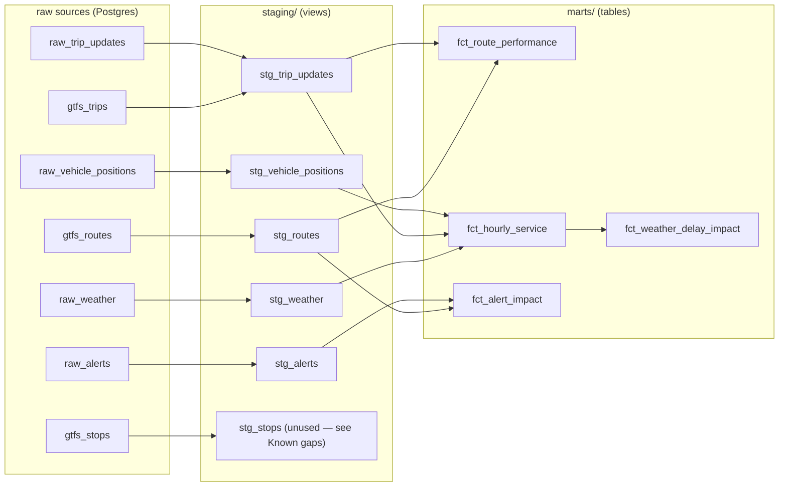

# Torino Pulse


A production data pipeline that continuously ingests live public transit and weather data for Turin, Italy, transforms it through a layered dbt model, and exposes findings through live dashboards.

Data has been collecting since **19 August 2026** and updates every 5–15 minutes around the clock — roughly 446,000 vehicle-position records a week (see [Ingestion volume](#ingestion-volume-by-day-of-week) in Findings).


**Live dashboard:**
[Turin Transit Dashboard](http://84.8.253.68:3000/public/dashboard/c893e417-08cc-4a87-b405-8a33fba2a81a)
---

## Why this exists

Turin's transit operator (GTT) publishes GTFS-Realtime feeds — vehicle positions, stop-level delay predictions, and service alerts — but nothing persists them. Each request returns a snapshot that is overwritten seconds later.

This project captures those snapshots on a schedule, stores them, and builds a historical record you can actually query: how the fleet size changes across the day, which routes deviate most from schedule, how weather correlates with service.

The interesting problems here are not the happy path. They are the ones documented under [Implementation notes](#implementation-notes): a dependency conflict that left every task silently failing while the containers reported healthy, a UID mismatch that made dbt die without printing anything, and a feed that emits `0` where it means `null`.

---

## Architecture

```
┌─────────────────────────────────────────────────────────────┐
│  SOURCES                                                    │
│                                                             │
│  GTT GTFS-RT          GTT GTFS-RT        GTT GTFS-RT        │
│  vehicle_position     trip_update        alerts             │
│  (protobuf)           (protobuf)         (protobuf)         │
│                                                             │
│  GTT Static GTFS      Open-Meteo                            │
│  (zip, 13 MB)         (JSON)                                │
└──────────────────────────┬──────────────────────────────────┘
                           │
              ┌────────────▼────────────┐
              │  AIRFLOW 2.10.4         │
              │  CeleryExecutor         │
              │                         │
              │  6 DAGs:                │
              │  · positions    5 min   │
              │  · trip_updates 5 min   │
              │  · alerts      15 min   │
              │  · weather     15 min   │
              │  · static_gtfs  daily   │
              │  · dbt_transform 15 min │
              └────────────┬────────────┘
                           │
              ┌────────────▼─────────────┐
              │  POSTGRES 13             │
              │                          │
              │  raw_vehicle_positions   │
              │  raw_trip_updates        │
              │  raw_alerts              │
              │  raw_weather             │
              │  gtfs_* (7 tables, incl. │
              │    1.1M stop_times rows) │
              └────────────┬─────────────┘
                           │
              ┌────────────▼────────────┐
              │  DBT 1.8.2              │
              │                         │
              │  staging/  (6 models)   │
              │  marts/    (3 models)   │
              │                         │
              │  39 data quality tests  │
              └────────────┬────────────┘
                           │
              ┌────────────▼────────────┐
              │  Metabase               │
              │  Live dashboards        │
              │  :3000                  │
              └─────────────────────────┘
```

Everything runs in Docker Compose on one Oracle Cloud VM.Standard.A1.Flex (2 OCPU ARM64, 12 GB RAM, 100 GB disk) in the Italy North (Turin) region — permanently free.

---

## Data sources

| Source | Format | Interval | What it gives you |
|---|---|---|---|
| `vehicle_position.aspx` | GTFS-RT protobuf | 5 min | Vehicle ID, route, trip, lat/lon, bearing, GPS timestamp |
| `trip_update.aspx` | GTFS-RT protobuf | 5 min | Per-stop arrival delay in seconds, license plate, wheelchair accessibility |
| `alerts.aspx` | GTFS-RT protobuf | 15 min | Service disruptions: cause, effect, severity, affected routes and stops |
| `gtt_gtfs.zip` | GTFS static | daily | 204 routes, 6,894 stops, 38,824 trips, 1.1M stop_times |
| Open-Meteo | JSON | 15 min | Temperature, precipitation, wind speed, WMO weather code |

No API keys required. The realtime feeds carry fewer fields than the GTFS-RT spec allows — `current_status`, `occupancy_status`, and `congestion_level` are all absent from GTT's output. Everything GTT does publish is stored.

---

## Stored columns

Everything the feeds publish is stored. Timestamps are UTC; staging models add local (Europe/Rome) time.

### Raw tables

| Table | Written by | Columns |
|---|---|---|
| `raw_vehicle_positions` | positions DAG | `id`, `vehicle_id`, `vehicle_label`, `route_id`, `trip_id`, `trip_start_time`, `trip_start_date`, `latitude`, `longitude`, `bearing`, `gps_timestamp`, `fetched_at` |
| `raw_trip_updates` | trip-updates DAG | `id`, `trip_id`, `route_id`, `trip_start_time`, `trip_start_date`, `vehicle_id`, `vehicle_label`, `license_plate`, `wheelchair_accessible`, `stop_sequence`, `arrival_delay_seconds`, `departure_delay_seconds`, `gps_timestamp`, `fetched_at` |
| `raw_alerts` | alerts DAG | `id`, `alert_id`, `content_hash`, `cause`, `effect`, `severity_level`, `header_text`, `description_text`, `url`, `active_period_start`, `active_period_end`, `informed_route_id`, `informed_stop_id`, `informed_trip_id`, `first_seen_at`, `last_seen_at`, `times_seen`, `fetched_at` |
| `raw_weather` | weather DAG | `id`, `observed_at`, `temperature_c`, `precipitation_mm`, `wind_speed_kmh`, `weather_code`, `fetched_at` |
| `gtfs_*` (routes, stops, trips, stop_times, ...) | static GTFS DAG | the standard GTFS columns plus `loaded_at`; rebuilt daily |
| `gtfs_trips_history` | static GTFS DAG | `trip_id`, `route_id`, `direction_id`, `trip_headsign`, `first_seen_at`, `last_seen_at`; never dropped |
| `gtfs_routes_history` | static GTFS DAG | `route_id`, `agency_id`, `route_short_name`, `route_long_name`, `route_desc`, `route_type`, `route_url`, `route_color`, `route_text_color`, `first_seen_at`, `last_seen_at`; never dropped |

`trip_id` values are reused across service days, so a trip is identified by `trip_id` plus `trip_start_date`. The realtime `route_id` is empty in `raw_trip_updates`; it is resolved through `gtfs_trips_history`.

### Mart columns

| Model | Columns |
|---|---|
| `fct_route_performance` | `route_id`, `route_short_name`, `route_long_name`, `route_mode`, `service_area`, `is_night_route`, `observations`, `trips_observed`, `avg_delay_seconds`, `median_delay_seconds`, `p90_delay_seconds`, `stddev_delay_seconds`, `max_early_seconds`, `max_late_seconds`, `pct_late`, `pct_early`, `pct_on_time`, `pct_not_late_3min`, `pct_not_late_5min`, `pct_wheelchair_accessible`, `first_observed_at`, `last_observed_at` |
| `fct_hourly_service` | `hour_bucket`, `local_hour`, `local_day_name`, `local_day_of_week`, `is_weekend`, `active_vehicles`, `active_routes`, `vehicles_on_a_trip`, `position_reports`, `delay_observations`, `trips_observed`, `avg_delay_seconds`, `median_delay_seconds`, `pct_late`, `avg_temperature_c`, `total_precipitation_mm`, `avg_wind_speed_kmh`, `had_precipitation`, `dominant_condition`, `is_sparse_hour` |
| `fct_alert_impact` | `route_id`, `route_short_name`, `route_long_name`, `route_mode`, `service_area`, `alert_id`, `effect`, `cause`, `severity_level`, `header_text`, `stops_affected`, `active_from_local`, `active_until_local`, `planned_duration`, `is_currently_active`, `first_seen_at_local`, `last_seen_at_local`, `times_observed` |
| `fct_weather_delay_impact` | `dominant_condition`, `had_precipitation`, `local_hour`, `local_day_name`, `weather_group`, `hours_observed`, `avg_temp_c`, `avg_precip_mm`, `avg_wind_kmh`, `avg_median_delay`, `avg_delay`, `avg_pct_late`, `avg_fleet_size` |

---

## Model layers

### staging

| Model | Purpose |
|---|---|
| `stg_vehicle_positions` | Drops `(0,0)` GPS readings. Adds local time and `has_assigned_trip`. |
| `stg_trip_updates` | Resolves `route_id` via static GTFS. Adds prediction drift columns and `is_en_route`. |
| `stg_alerts` | Collapses alert/entity pairs, carries the observation window. |
| `stg_weather` | Deduplicates per observation time. Translates WMO codes to conditions. |
| `stg_routes` | Human-readable names, transport mode, urban/extra-urban, night flag. |
| `stg_stops` | Coordinates and wheelchair boarding, filtered to valid geometry. |

### marts

| Model | Grain | Purpose |
|---|---|---|
| `fct_route_performance` | one row per route | Median, p90, stddev, punctuality bands |
| `fct_hourly_service` | one row per local hour | Fleet size + delay + weather, joined |
| `fct_alert_impact` | one row per (route, alert) | Which lines are disrupted and how |
| `fct_weather_delay_impact` | one row per (condition, precipitation, local hour) | Delay grouped into dry / rainy / foggy buckets |

### Lineage



Generated from each model's actual `ref()`/`source()` calls, not hand-drawn — `fct_weather_delay_impact` is the one mart built on another mart rather than directly on staging. Full column-level docs (including tests and descriptions) are available locally via `dbt docs generate && dbt docs serve`.

---

## Data quality notes

### GPS dropouts
About 2.3% of vehicle positions report `latitude = 0, longitude = 0`. Filtered in staging.

### One third of trips report no delay data
33% of stop-time updates report `arrival_delay_seconds = 0`. Three checks decided how to treat them:

**Uniformity.** The zero rate is 31–34% at every stop position, from stop 2 through stop 15.

**Trip-level clustering.** 2,229 of 6,717 trips report zero at every single stop.

**Vehicle-level consistency.** 80% of vehicles sit firmly in one camp (always zero or never zero).

The evidence fits missing data encoded as `0`. `fct_route_performance` excludes them. This cannot be proven without documentation from GTT, so the model header states the reasoning rather than asserting a fact.

### First stop always reads zero
The first stop reports zero delay because the vehicle has not departed. The `is_en_route` flag (`stop_sequence > 1`) excludes it.

### Delay drifts negative along a trip
Median delay falls steadily with stop position: −25s at stop 2, −59s at stop 5, −98s at stop 15. Vehicles get progressively further ahead of schedule — suggesting padded timetables toward the end of routes.

### Three things that shaped the history behind the marts

**`trip_id` is reused across service days.** GTT publishes the same `trip_id` for a scheduled trip on every day it runs, so a trip is identified by `trip_id` plus `trip_start_date`. Until 3 November 2026 the window functions in `stg_trip_updates` were partitioned by `(trip_id, stop_sequence)` only, which made every later day's observation supersede the earlier ones: `is_latest_observation` kept just the last day each trip was seen. The partitions now include `trip_start_date`; `fct_route_performance` went from roughly 0.7M to 2.8M observations and its history now reaches back to 19 August.

**Route attribution depends on feed history.** The realtime feed leaves `route_id` empty, and GTT rotates `trip_id`s with each new static feed. The static GTFS tables are rebuilt daily, so before 3 November 2026 an old observation could only be matched to a route if its `trip_id` was still in the current feed. `gtfs_trips_history` and `gtfs_routes_history` now keep every `trip_id` and route ever seen, but only from that date onward. Observations whose `trip_id` was never captured have no route and are left out of the route-level marts. Of the 10.49M non-zero en-route delay observations, 7.70M (73%) have no route. The share by month:

| Month | Delay observations | Without a route | OTP ±60s (all observations) |
|---|---|---|---|
| Aug 2026 (from 19 Aug) | 1.61M | 84% | 23.6% |
| Sep 2026 | 4.04M | 100% | 27.2% |
| Oct 2026 | 4.40M | 52% | 27.3% |
| Nov 2026 (to 3 Nov) | 0.44M | 0% | 27.8% |

So `fct_route_performance` (2.79M observations, 87 routes) is effectively an October–November view, with a little August and no September. Network-level punctuality does not need a route and is stable at 23.6–27.8% in every month, so the headline OTP is not an artefact of which routes could be resolved; route rankings are. Weather and fleet-size figures come from `fct_hourly_service`, which does not depend on route attribution.

**No trip-update data on 10–11 September 2026.** `raw_trip_updates` has no rows on those two days, although vehicle positions were collected normally. `fct_hourly_service` therefore has no delay figures for them. There is nothing to backfill.

---

## Findings---

## Findings

Data has been collected since **19 August 2026** (76 days as of 3 November 2026), with one gap: `raw_trip_updates` is empty on 10–11 September (see [Data quality notes](#data-quality-notes)). The route-level figures below cover **2.79M delay observations on 87 routes**, which is the 27% of all non-zero en-route observations that could be attributed to a route; they mostly reflect October and early November (see [Data quality notes](#data-quality-notes)). Network-level, weather and fleet figures do not depend on route attribution. Findings are current **as of 3 November 2026**; the queries behind every number are in [`analysis/findings.sql`](analysis/findings.sql) and are meant to be re-run as the window moves.

### Network-level punctuality vs European benchmarks

GTT's on-time performance (OTP), defined as arriving within ±60 seconds of schedule, sits well below European standards:

| Network | OTP |
|---|---|
| Hamburg HVV (best EU) | 93% |
| European average | ~75% |
| London TfL | 76% |
| **GTT Turin — tram** | **25.7%** |
| **GTT Turin — bus** | **27.5%** |

The low OTP reflects a structural pattern, not random variation: across 2,789,745 observations on 87 routes (network OTP 27.0%), the network runs systematically ahead of schedule (network median delay = −61s), which means timetables are padded and vehicles arrive early rather than on time. A rider who arrives at the scheduled departure time risks missing a vehicle that left early.

### Buses and trams are close

| Mode | Routes | Observations | OTP (±60s) | pct_late | Median delay | Not >5 min late |
|---|---|---|---|---|---|---|
| Tram | 8 | 705,277 | 25.7% | 21.3% | −69s | 92.6% |
| Bus | 77 | 2,061,862 | 27.5% | 23.8% | −58s | 92.6% |
| Metro | 1 | 22,272 | 22.1% | 11.1% | −119s | 98.5% |
| Funicular | 1 | 334 | 24.3% | 11.4% | −102s | 97.3% |

Trams are late less often than buses (21.3% vs 23.8%) but also arrive early more often (median −69s vs −58s), which is why their ±60s OTP comes out slightly lower. On a one-sided "not more than 5 minutes late" threshold the two modes are identical at 92.6%. The metro and funicular rows are one line each, and the funicular has only 334 observations, so they are not comparable to the bus and tram figures. Earlier readings of this data were based on a much shorter window; treat any gap between modes as provisional.

### Most problematic routes

Routes with the highest rate of late arrivals (observations ≥ 200):

| Route | pct_late | p90 delay | stddev | observations |
|---|---|---|---|---|
| 17 | 46.3% | +521s | 2,720 | 102,156 |
| 17/ | 40.4% | +435s | 293 | 30,087 |
| 68+ | 40.0% | +470s | 359 | 6,276 |
| 6 | 36.1% | +382s | 302 | 21,009 |
| 68 | 35.8% | +400s | 1,507 | 81,484 |
| 61 | 33.7% | +383s | 286 | 68,784 |

Route 17 and its variant 17/ were at the top of the October reading too, so this looks like a persistent pattern rather than a one-off.

### Most unpredictable routes

Routes with the highest delay variance (stddev), meaning the schedule is least useful as a predictor:

| Route | stddev (seconds) | pct_late | observations |
|---|---|---|---|
| 159 | 5,235 | 5.2% | 541 |
| 17 | 2,720 | 46.3% | 102,156 |
| 1C | 2,414 | 13.7% | 3,850 |
| 5 | 1,739 | 24.7% | 62,013 |
| 55 | 1,650 | 23.4% | 97,449 |
| 36 | 1,538 | 23.4% | 44,249 |

A high stddev means the vehicle sometimes arrives very early and sometimes very late — the schedule gives riders almost no useful information. Route 159 has only 541 observations, so its figure is the least certain; route 17 is both frequently late and highly variable.

### Most reliable routes

Ranked by OTP (±60s), observations ≥ 200:

| Route | OTP | pct_late | stddev | observations |
|---|---|---|---|---|
| 58/ | 36.5% | 16.5% | 169 | 12,987 |
| VE1 | 36.3% | 29.0% | 178 | 1,161 |
| 12 | 35.0% | 24.5% | 214 | 39,092 |
| 60 | 34.5% | 33.1% | 276 | 33,498 |
| 36 | 34.4% | 23.4% | 1,538 | 44,249 |
| 58 | 34.4% | 23.5% | 223 | 13,639 |

"Reliable" here only means a higher share of arrivals within ±60s, and even the best route reaches 36.5%. Route 36 ranks high on OTP yet has a stddev of 1,538, so a minority of extreme values dominates its variance; route 60 combines good OTP with 33.1% late.

### Fleet cycle

Average active vehicles by hour of day (hours with fewer than 1,500 position reports are excluded as partial/unreliable):

```
00:00  146   ┃━━━━━━━━━━                overnight low
05:00  265   ┃━━━━━━━━━━━━━━━━━         service resumes
07:00  448   ┃━━━━━━━━━━━━━━━━━━━━━━━━━━━━━━
08:00  457   ┃━━━━━━━━━━━━━━━━━━━━━━━━━━━━━━  daily peak
10:00  411   ┃━━━━━━━━━━━━━━━━━━━━━━━━━━━
14:00  384   ┃━━━━━━━━━━━━━━━━━━━━━━━━━━
18:00  404   ┃━━━━━━━━━━━━━━━━━━━━━━━━━━━
20:00  368   ┃━━━━━━━━━━━━━━━━━━━━━━━━━
22:00  161   ┃━━━━━━━━━━━               night routes winding down
```

### Alerts

Detours account for 62% of every alert raised since collection began (676 of 1,098 distinct alerts), with 164 active as of this snapshot. The rest split across `OTHER_EFFECT` (266), `NO_EFFECT` (62), `MODIFIED_SERVICE` (57), and a long tail of rarer effects.

### Weather vs delay

| Condition | Hours observed | avg pct_late | avg median delay |
|---|---|---|---|
| Dry | 1,106 | 21.7% | −64s |
| Rainy | 77 | 22.8% | −58s |
| Foggy | 35 | 18.0% | −72s |

The differences here are small (a few points of `pct_late`, tens of seconds of median delay) and the rainy/foggy samples are thin (77 and 35 hours respectively) next to 1,106 dry hours. This reads as a weak or inconclusive weather effect, not a confirmed one — there isn't enough data yet to say weather meaningfully moves GTT's delays either way.

### Ingestion volume by day of week

Averaged across the full collection window (19 August – 3 November 2026, 11 samples per weekday), vehicle-position volume is lower on weekends, when fewer vehicles run:

| Day | Avg. position reports/day |
|---|---|
| Tuesday | ~76,000 |
| Wednesday | ~70,800 |
| Thursday | ~70,600 |
| Friday | ~68,600 |
| Monday | ~68,500 |
| Saturday | ~55,100 |
| Sunday | ~36,200 |

That's roughly **446,000 vehicle-position records a week**, ingested automatically on a 5-minute schedule with no manual intervention.

---

## Running it

### Requirements
- Docker + Docker Compose
- 4 GB RAM minimum (12 GB recommended — see [Swap note](#swap-is-mandatory-on-a-4-gb-vm))

### Setup

```bash
git clone https://github.com/imantahami/torino-pulse.git
cd torino-pulse

mkdir -p logs plugins config
echo "AIRFLOW_UID=$(id -u)" > .env

docker compose up airflow-init
docker compose up -d
```

Wait 3–5 minutes, then:

```bash
docker compose ps          # all services should read (healthy)
docker exec -it torino-pulse-postgres-1 psql -U airflow -c "CREATE DATABASE torino_pulse;"
```

Airflow UI at `http://localhost:8080`, credentials `airflow` / `airflow`. Unpause the six DAGs.

### Metabase

```bash
docker exec -it torino-pulse-postgres-1 psql -U airflow -c "CREATE DATABASE metabase;"
docker compose -f docker-compose.metabase.yaml up -d
```

### Verifying data flow

```bash
docker exec -it torino-pulse-postgres-1 psql -U airflow -d torino_pulse -P pager=off -c "
SELECT 'positions' AS t, COUNT(*), NOW()-MAX(fetched_at) AS since_last FROM raw_vehicle_positions
UNION ALL SELECT 'trip_updates', COUNT(*), NOW()-MAX(fetched_at) FROM raw_trip_updates
UNION ALL SELECT 'alerts', COUNT(*), NOW()-MAX(last_seen_at) FROM raw_alerts
UNION ALL SELECT 'weather', COUNT(*), NOW()-MAX(fetched_at) FROM raw_weather;"
```

`since_last` should stay under the DAG interval.

### Running dbt manually

```bash
docker compose exec airflow-scheduler bash -c \
  "cd /opt/airflow/dbt/torino_pulse && dbt run --profiles-dir . && dbt test --profiles-dir ."
```

### Connecting Power BI

Postgres is not exposed to the internet. Open an SSH tunnel instead:

```bash
ssh -i <key> -L 5432:localhost:5432 ubuntu@<server-ip>
```

Then point Power BI at `localhost:5432`, database `torino_pulse`, mode `DirectQuery`.

---

## Implementation notes

### A dependency conflict that reported itself as healthy

After adding `dbt-core` to `_PIP_ADDITIONAL_REQUIREMENTS`, every DAG stopped producing data. All six containers showed `healthy`. The UI showed all DAGs unpaused. Nothing said broken.

The scheduler log had it:

```
AttributeError: module 'redis' has no attribute 'client'
```

Installing dbt had pulled in a `redis` version incompatible with the `kombu` build Celery uses. Fixed by pinning `redis==4.6.0`. The lesson: green health checks describe the process, not the work.

### UID mismatch makes dbt exit silently

`dbt --version` worked. `dbt run` printed nothing and exited with code 2 — no traceback, no log file.

The project directory was owned by UID 1000 (host); the container runs as UID 50000. dbt died before it had anywhere to write the error.

Fixed by:
```bash
echo "AIRFLOW_UID=1000" > .env
sudo chown -R 1000:1000 ~/torino-pulse
```

### Deduplicating alerts on ingest

`raw_alerts` grew at roughly 38 MB/hour. Each 15-minute fetch re-inserted all active alerts across every affected entity. The fix hashes content and upserts:

```sql
ON CONFLICT (alert_id, content_hash,
             COALESCE(informed_route_id, ''),
             COALESCE(informed_stop_id, ''),
             COALESCE(informed_trip_id, ''))
DO UPDATE SET last_seen_at = EXCLUDED.last_seen_at,
              times_seen   = raw_alerts.times_seen + 1
```

Result: 245,307 rows collapsed to 8,634, and 193 MB to 9 MB.

### COPY for the large GTFS file

`stop_times.txt` is 70 MB and 1.1M rows. Row-by-row INSERT takes tens of minutes. Streaming into COPY takes 24 seconds.

### CASCADE when reloading reference tables

The static GTFS loader recreates tables daily. Once dbt staging views existed on top of them, `DROP TABLE` started failing with dependency errors. `DROP TABLE ... CASCADE` is correct here — the views are rebuilt by the next dbt run.

### Migrating from Azure to Oracle Cloud

Data was migrated via `pg_dump` on the source, `scp` through a laptop as intermediary, and `pg_restore` on the destination. 842,864 positions and 5.2M trip_updates transferred without loss.

### Oracle Cloud ARM

Oracle Always Free provides 2 OCPU ARM64 and 12 GB RAM permanently. The Italy North (Turin) region was selected — the datacenter is in the same city as the transit network it monitors.

Oracle's Always Free ARM allocation was reduced from 4 OCPU / 24 GB to 2 OCPU / 12 GB in June 2026 with no public announcement.

### Swap is mandatory on a 4 GB VM

Airflow's Compose stack asks for 4 GB. A 3.8 GB usable VM dies under load. Four GB of swap fixes it. Setting `AIRFLOW__CORE__LOAD_EXAMPLES: 'false'` cut swap usage from 2.6 GB to 800 MB.

### BashOperator instead of Astronomer Cosmos

Cosmos does not install cleanly alongside Airflow 2.10.4 — pip enters dependency backtracking without converging. Two BashOperator tasks work fine and install in seconds.

---

## Known gaps

**`_PIP_ADDITIONAL_REQUIREMENTS` is development-only.** A custom image is the correct fix.

**`shapes.txt` is not loaded** — route geometry for mapping is available but unused.

**GTFS static history starts on 3 November 2026.** Observations recorded earlier can only be attributed to a route if their `trip_id` is still in a captured feed; the rest are excluded from route-level marts.

**No trip-update data on 10–11 September 2026.** The collector recorded nothing on those days.

---

## Roadmap

- [x] Re-run analysis after 30 days of collection
- [ ] Custom Airflow image, replacing `_PIP_ADDITIONAL_REQUIREMENTS`
- [x] Secrets via environment variables
- [ ] Load `shapes.txt` for route map visualisation
- [x] Versioned GTFS history so route attribution survives feed rotation
- [ ] GitHub Actions running `dbt test` on PRs

---

## Stack

Airflow 2.10.4 · dbt-core 1.8.2 · Postgres 13 · Redis 7.2 · Docker Compose · Python 3.12 · Metabase · Oracle Cloud ARM (Ubuntu 24.04)

## Data attribution

Transit data © [GTT Torino](https://www.gtt.to.it/), published as open data.
Weather data from [Open-Meteo](https://open-meteo.com/), CC BY 4.0.
